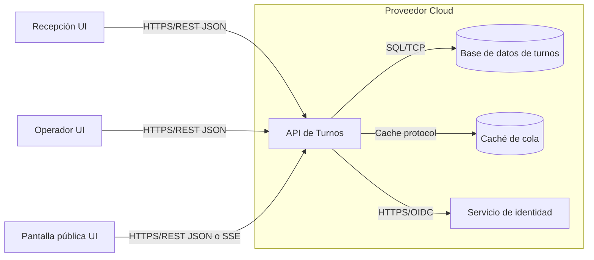

# cc-turnos-cprl

Proyecto de **Cloud Computing (MUII-UGR)** para modernizar la gestión de turnos del centro de prevención de riesgos laborales con enfoque cloud-native.

> Estado actual: ** Definición y preparación de Hito 1**.  

## 1) Problema, objetivos y casos de uso

### Problema
La operativa de turnos basada en scripts heredados dificulta trazabilidad, escalabilidad y evolución técnica. Es una aplicación de Ubuntu 16.04 en php con base de datos PostgreSQL antigua, sin separación de responsabilidades ni control de versiones.
### Objetivos
- Definir una arquitectura cloud-native modular y evolutiva.
- Establecer un flujo claro para recepción, operadores y pantalla pública.
- Preparar la base de trabajo en GitHub (ramas, plantillas y backlog) para siguientes hitos.

### Casos de uso principales
1. **Recepción** registra paciente y genera turno que se imprime en la impresora.
2. **Operador** consulta cola y llama al siguiente turno.
3. **Pantalla pública** muestra llamadas activas y estado de cola sin datos sensibles.

## 2) Arquitectura propuesta (diseño)

Arquitectura objetivo (propuesta, no implementada):

### Componentes y comunicaciones
- **UIs (recepción/operador/pública):** clientes web.
- **API de turnos:** lógica de negocio y estados del turno.
- **Base de datos:** persistencia transaccional.
- **Caché:** lectura rápida de colas/llamadas.
- **Identidad:** autenticación/autorización para recepción y operadores.

## 3) Justificación NIST SP 800-145 (5 características esenciales)

Fuente oficial: **NIST SP 800-145** (*The NIST Definition of Cloud Computing*):  
- https://doi.org/10.6028/NIST.SP.800-145  
- https://csrc.nist.gov/publications/detail/sp/800-145/final

Aplicación al proyecto (**objetivo de diseño**, no estado actual):

1. **On-demand self-service**: aprovisionar entornos (dev/test/prod) sin gestión manual del proveedor.
2. **Broad network access**: acceso por red a UI/API desde puestos clínicos autorizados.
3. **Resource pooling**: uso compartido de recursos cloud entre servicios del sistema.
4. **Rapid elasticity**: escalar API y capa pública en picos de demanda.
5. **Measured service**: medir uso para costes, capacidad y optimización operativa.

## 4) Mapeo de actores NIST SP 500-292 e impacto económico

Fuente oficial: **NIST SP 500-292** (*Cloud Computing Reference Architecture*):  
- https://doi.org/10.6028/NIST.SP.500-292  
- https://www.nist.gov/publications/nist-cloud-computing-reference-architecture

> Nota terminológica: en NIST el actor es **Cloud Carrier**; en este proyecto se referencia como “**operador**” del transporte/conectividad.

| Actor NIST | Papel en la arquitectura propuesta | Impacto económico esperado |
|---|---|---|
| Consumidor (Cloud Consumer) | Centro de prevención de riesgos laborales de Granada que consume la solución SaaS/PaaS | Pago por uso  |
| Proveedor (Cloud Provider) | Plataforma cloud que hospeda API, datos y red | Costes variables por cómputo, red y almacenamiento |
| Intermediario (Cloud Broker) | Agregación/optimización multi-servicio cloud (si aplica) | Optimización de costes y negociación de SLA |
| Auditor (Cloud Auditor) | Revisión de seguridad, cumplimiento y rendimiento | Reduce riesgo de incumplimiento y costes de incidente |
| Operador / Carrier | Conectividad segura entre clientes y nube | Coste de comunicaciones y calidad de servicio |

## 5) API REST inicial (resumida)

Especificación inicial de referencia para desarrollo posterior.

| Endpoint | Método | Finalidad | Payload JSON representativo |
|---|---|---|---|
| `/api/v1/turnos` | `POST` | Crear turno desde recepción | `{"pacienteRef":"P-001","motivo":"consulta"}` |
| `/api/v1/turnos` | `GET` | Listar cola/estado de turnos | `{"estado":"en_espera","limit":20}` *(query params)* |
| `/api/v1/turnos/{id}/llamar` | `POST` | Llamar turno desde operador | `{"operadorId":"op-12","puesto":"box-3"}` |
| `/api/v1/pantalla/llamadas` | `GET` | Obtener llamadas visibles en pantalla pública | `{"items":[{"codigo":"A-42","puesto":"box-3"}]}` |
| `/api/v1/auth/login` | `POST` | Inicio de sesión de recepción/operador | `{"usuario":"recepcion1","password":"***"}` |

Nota: la API REST es un diseño inicial y puede evolucionar según necesidades de implementación y seguridad.

## 6) Tecnologías previstas y evolución por hitos

### Tecnologías previstas (no implementadas aún)
- Frontend modular (alineable con enfoque microfrontend).
- Backend API REST para dominio de turnos.
- Base de datos relacional + caché para lectura rápida.
- Plataforma cloud con servicios gestionados y observabilidad.

### Evolución por hitos
- **Hito 1:** definición de proyecto, arquitectura de referencia, backlog y configuración GitHub.
- **Hito 2:** empaquetado cloud-native, entorno local e integración continua.
- **Hito 3:** IaC y verificación del reconciler pattern.
- **Hito 4:** despliegue continuo, reconciliación y seguridad.
- **Hito 5:** observabilidad, carga y release final.

(Referencia de hitos: https://github.com/aaronblanco/CC-26-27/blob/main/hitos/hito1.md)

## 7) Estrategia de ramas y commits

- Rama protegida principal: `main`.
- Trabajo incremental en ramas `feature/*`.
- Integración mediante Pull Request con revisión.
- Convención de commits semánticos: `feat:`, `fix:`, `docs:`, `refactor:`, `test:`, `chore:`.

## 8) Backlog inicial propuesto (para GitHub Issues/Projects)

> Propuesta documental. **No implica** que Issues, etiquetas, milestones o Projects estén ya creados en GitHub.

### Hito 1
1. **US-01 Definición de dominio y alcance**  
   Como responsable del proyecto, quiero documentar problema, objetivos y casos de uso, para fijar alcance evaluable.  
   **Criterios:** README incluye problema, objetivos y 3 casos de uso.

2. **US-02 Diseño arquitectónico cloud-native**  
   Como responsable técnico, quiero un diagrama de arquitectura con componentes y protocolos, para guiar implementación posterior.  
   **Criterios:** diagrama Mermaid y descripción coherente de componentes.

3. **US-03 Marco NIST aplicado**  
   Como responsable del proyecto, quiero justificar SP 800-145 y mapear SP 500-292, para encuadrar formalmente el diseño cloud.  
   **Criterios:** 5 características y 5 actores explicados con impacto económico.

4. **US-04 Plantillas y flujo GitHub**  
   Como desarrollador, quiero plantillas de Issue/PR y normas de ramas/commits, para estandarizar el trabajo.  
   **Criterios:** `.gitignore`, plantilla de user-story y PR template presentes.

### Hito 2
5. **US-05 Alta de turnos en recepción**  
   Como recepcionista, quiero registrar turnos, para iniciar cola de atención.  
   **Criterios:** endpoint de creación y validaciones mínimas.

6. **US-06 Consulta de cola para operadores**  
   Como operador, quiero ver cola ordenada, para llamar pacientes con criterio claro.  
   **Criterios:** endpoint de consulta y estados básicos definidos.

### Hito 3
7. **US-07 Infraestructura declarativa**  
   Como operador del sistema, quiero aprovisionamiento IaC, para reproducibilidad y control de cambios.  
   **Criterios:** recursos mínimos definidos como código y trazables.

### Hito 4
8. **US-08 Despliegue continuo seguro**  
   Como responsable DevOps, quiero pipeline CD con controles de seguridad, para reducir riesgo en entregas.  
   **Criterios:** política de despliegue y validaciones automáticas.

### Hito 5
9. **US-09 Observabilidad y métricas de servicio**  
   Como responsable de operación, quiero métricas, logs y trazas, para medir calidad y coste.  
   **Criterios:** definición de indicadores y umbrales de alerta.

## 9) Referencias

- Requisitos de la asignatura y Hito 1: https://github.com/aaronblanco/CC-26-27/blob/main/hitos/hito1.md
- NIST SP 800-145: https://doi.org/10.6028/NIST.SP.800-145
- NIST SP 500-292: https://doi.org/10.6028/NIST.SP.500-292
- Arquitectura de referencia microfrontend (Junta de Andalucía):  
  https://desarrollo.juntadeandalucia.es/recursos/reglas-pautas/arquitectura-referencia-microfrontend
- GitHub copilot: Formateo y extensión de README.md, diagramas Mermaid y tablas de backlog.
