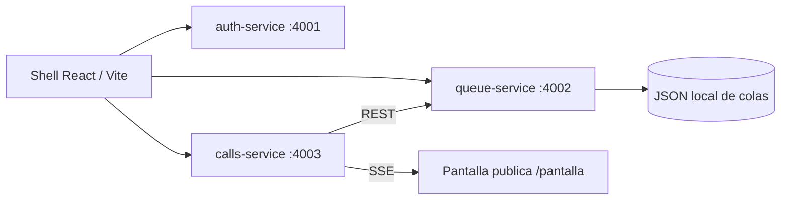

# cc-turnos-cprl

Aplicacion de gestion de turnos para un centro sanitario. Permite crear e imprimir tickets desde recepcion, gestionar llamadas desde un puesto de operador y mostrar las llamadas publicas sin datos personales.

## Resumen actual

La aplicacion utiliza React/Vite para la interfaz y tres servicios Node.js/Express con responsabilidades separadas:

- **Autenticacion y usuarios:** inicio de sesion, identidad y roles.
- **Gestion de turnos:** colas, codigos, persistencia y estados.
- **Atencion y llamadas:** asignacion de turnos, llamadas, ausencias y avisos publicos.

Se sigue un patron **Shell + modulos funcionales**: el Shell aporta navegacion y experiencia comun, mientras recepcion, operador y pantalla publica mantienen responsabilidades separadas. La comunicacion se realiza mediante APIs REST y SSE. No se utiliza Module Federation ni una infraestructura distribuida mientras no resulte necesaria.



## Requisitos y ejecucion

- Node.js 20 o superior y npm para ejecutar los procesos directamente.
- Docker con Compose para levantar el entorno completo en contenedores.

### Ejecucion directa

```bash
npm ci
npm run dev
```

URLs:

| Componente | URL |
|---|---|
| Shell | http://localhost:5173 |
| Pantalla publica | http://localhost:5173/pantalla |
| Auth service | http://localhost:4001 |
| Queue service | http://localhost:4002 |
| Calls service | http://localhost:4003 |

Tambien se puede arrancar cada servicio con `npm run dev:auth`, `npm run dev:queue`, `npm run dev:calls` y `npm run dev:web`. Los puertos se pueden cambiar con `AUTH_PORT`, `QUEUE_PORT`, `CALLS_PORT` y `QUEUE_URL`. `JWT_SECRET` permite sustituir el valor local de desarrollo.

### Ejecucion con Docker Compose

```powershell
Copy-Item .env.example .env
docker compose up --build
```

La aplicacion completa queda disponible en `http://localhost:8080`; la pantalla publica esta en `http://localhost:8080/pantalla`. Compose levanta cuatro contenedores, usa redes separadas y conserva los turnos en el volumen `queue-data`.

Comandos utiles:

```bash
docker compose ps
docker compose logs -f
docker compose down
docker compose down -v
```

El ultimo comando elimina tambien los datos persistentes de cola.

## Usuarios de demostracion

Son credenciales ficticias solo para desarrollo local:

| Usuario | Contrasena | Rol | Permiso principal |
|---|---|---|---|
| `recepcion` | `Recepcion123!` | Recepcion | Crear turnos e imprimir tickets |
| `operador` | `Operador123!` | Operador | Llamar, repetir y cerrar atenciones |
| `admin` | `Admin123!` | Administrador | Consultar usuarios y reiniciar datos |

El administrador puede reiniciar la cola con `POST /api/queues/reset`. Los datos se guardan en `services/queue/data/queue.json`, se crean al arrancar y estan ignorados por Git.

## Flujo principal

1. Abre la aplicacion y entra como `recepcion`.
2. Selecciona un servicio, genera un turno y pulsa **Imprimir ticket**.
3. Abre `/pantalla` en otra pestana y pulsa **Activar audio** una vez para cumplir la politica del navegador.
4. Cierra sesion, entra como `operador`, selecciona el mismo servicio y llama al siguiente turno.
5. Comprueba el aviso visual y sonoro en la pantalla publica; despues repite, finaliza o marca ausente.

## Contratos REST principales

Todos los endpoints protegidos usan `Authorization: Bearer <token>`. Los errores siguen `{ "error": "CODIGO", "message": "Descripcion" }`.

| Metodo y ruta | Autorizacion | Peticion | Respuesta |
|---|---|---|---|
| `POST /api/auth/login` | Publica | `{ "username": "recepcion", "password": "..." }` | `{ "token": "...", "user": { "role": "recepcion" } }` |
| `GET /api/services` | Publica | Ninguna | `{ "items": [{ "id": "general", "name": "Medicina general" }] }` |
| `POST /api/queues/tickets` | Recepcion | `{ "service": "general" }` | `201 { "ticket": { "code": "G-001", "status": "waiting" } }` |
| `GET /api/queues/tickets?status=waiting` | Recepcion, operador, admin | Ninguna | `{ "items": [...] }` |
| `POST /api/calls/next` | Operador | `{ "service": "general" }` | `201 { "call": { "code": "G-001" }, "ticket": {...} }` |
| `POST /api/calls/:id/repeat` | Operador | Ninguna | `201 { "call": {...} }` |
| `POST /api/calls/:id/finish` | Operador | `{ "status": "completed" }` o `absent` | `{ "ticket": { "status": "completed" } }` |
| `GET /api/calls/current` | Publica | Ninguna | `{ "current": {...}, "items": [...] }` |
| `GET /api/calls/events` | Publica | SSE | Eventos `snapshot` y `call` con codigo y destino |

Los estados y transiciones son: `waiting -> called -> completed` o `absent`. El backend rechaza transiciones fuera de ese grafo con HTTP 409. El contador se reinicia por servicio y dia, por lo que `general`, `enfermeria` y `prevencion` tienen ambitos independientes.


## Pruebas

```bash
npm ci
npm test
npm run build
npm run test:integration
```

La prueba unitaria cubre transiciones de estado y permisos. La prueba integrada usa el entorno levantado en Compose y verifica login de recepcion, creación de turno, login de operador, llamada coincidente y disponibilidad de la pantalla pública.

## Integracion Continua

El workflow [.github/workflows/ci.yml](.github/workflows/ci.yml) se ejecuta en `push` y `pull_request` sobre `main`. Valida los Dockerfiles, ejecuta pruebas unitarias y compilación, construye el entorno con Compose y ejecuta el chequeo integrado. En cambios publicados a `main`, publica las cuatro imágenes en GHCR con el SHA del commit y `latest`.


## Referencias oficiales

Se han consultado la [Arquitectura de referencia Microfrontend](https://desarrollo.juntadeandalucia.es/recursos/reglas-pautas/arquitectura-referencia-microfrontend), la [Guia de desarrollo de soluciones web-microfrontend](https://desarrollo.juntadeandalucia.es/recursos/reglas-pautas/guia-desarrollo-soluciones-web-microfrontend) y la [Norma para el desarrollo de microfrontends](https://desarrollo.juntadeandalucia.es/recursos/reglas-pautas/norma-para-el-desarrollo-microfrontends). La guia tambien enlaza el [tema Bootstrap de la Junta](https://gitlab.juntadeandalucia.es/portal-jjaa/sass-junta-andalucia) y su [CDN de componentes](https://cdn.juntadeandalucia.es/components/docs/).
Copilot se ha usado para documentación y refactorización de codigo, pero no para la logica de negocio ni la seguridad.

No se ha incorporado ningun logotipo oficial ni identidad grafica autorizada. 